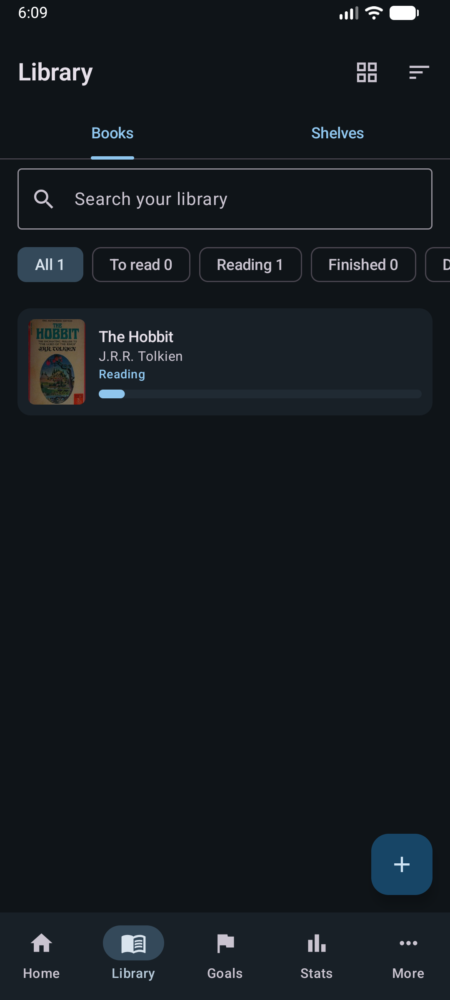
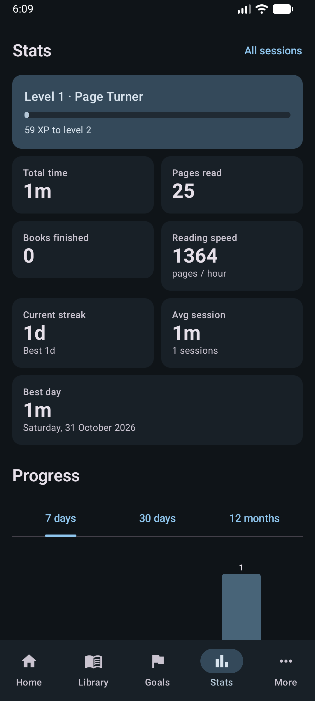
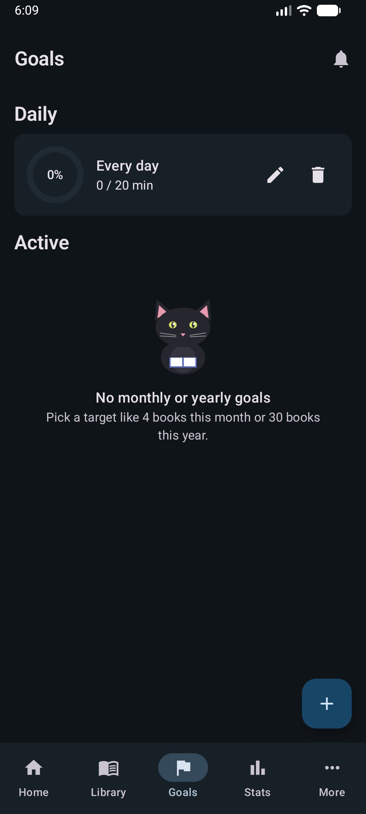

<p align="center">
  
</p>

<h1 align="center">📖 Pagewise</h1>

<p align="center">
  An Android reading tracker built with <b>Kotlin</b> and <b>Jetpack Compose</b>.<br>
  Track your books, time your reading sessions, hit your goals, and keep notes — all in a clean Material 3 interface. ✨
</p>

<p align="center">
  
  
  
  
  
  
</p>

---

## 📸 Screenshots

<p align="center">
  
  &nbsp;
  
  &nbsp;
  
</p>
<p align="center">
  
  &nbsp;
  
  &nbsp;
  
</p>
<p align="center">
  <sub>🏠 Home&nbsp;·&nbsp;📚 Library&nbsp;·&nbsp;📖 Book detail&nbsp;&nbsp;|&nbsp;&nbsp;📊 Stats&nbsp;·&nbsp;🎯 Goals&nbsp;·&nbsp;⋯ More</sub>
</p>

---

## ✨ Features

- 📚 **Library & shelves** — organize your books across custom shelves, with cover art.
- ➕ **Add books fast** — search an online catalogue, scan an ISBN barcode, or capture details with the camera (ML Kit text recognition).
- ⏱️ **Reading timer** — a foreground-service session timer with optional ambient background sounds. 🎧
- 📊 **Stats & insights** — reading statistics, pace, and infographics for your habits.
- 🎯 **Goals, achievements & readathons** — set reading goals, earn achievements 🏆, and run readathons.
- 📝 **Notes** — per-book notes and highlights.
- 🤖 **Reading assistant** — in-app helper including word definitions lookup.
- 🎨 **Personalization** — light/dark themes 🌙, appearance settings, and a selection of reading fonts (Atkinson Hyperlegible, Literata, Lora, Nunito, Playfair).
- 🔔 **Reminders** — reading notifications.

## 🛠️ Tech stack

- 🧩 **Language:** Kotlin (JVM 17)
- 🎨 **UI:** Jetpack Compose + Material 3, Navigation Compose, Material Icons Extended
- 🏗️ **Architecture:** ViewModel + repository, Compose lifecycle runtime
- 💾 **Persistence:** Room (with KSP), DataStore Preferences
- ⚙️ **Background work:** WorkManager, foreground `ReadingService`
- 🌐 **Networking:** OkHttp + kotlinx.serialization, Coil for image loading
- 📷 **Camera / scanning:** CameraX, ML Kit Barcode Scanning & Text Recognition

## 📋 Requirements

- 📱 **minSdk:** 26 (Android 8.0)
- 🎯 **targetSdk / compileSdk:** 36
- 🔖 **Current version:** 2.0.0

## 🔨 Building

```bash
./gradlew assembleRelease
```

> ⚠️ The release build is currently signed with the local debug key so it can be installed for testing. Replace with a real release keystore before publishing to the Play Store.

## 🚀 Releases

Prebuilt APKs are available on the [Releases page](https://github.com/phanimapvs/pagewise/releases):

| Version | Download |
|---------|----------|
| 🆕 [v2.0](https://github.com/phanimapvs/pagewise/releases/tag/v2.0) *(latest)* | `Pagewise-2.0.apk` |
| 📦 [v1.0](https://github.com/phanimapvs/pagewise/releases/tag/v1.0) | `Pagewise-1.0.apk` |

## 🔐 Permissions

| Permission | Why |
|------------|-----|
| 🌐 `INTERNET` | Catalogue search, cover art, definitions |
| 📷 `CAMERA` | ISBN barcode scanning and text capture |
| 🔔 `POST_NOTIFICATIONS` | Reading reminders and session notifications |
| ⏱️ `FOREGROUND_SERVICE` | Keeps the reading timer running reliably |

<p align="center"><sub>Made with ☕ and 📚 — happy reading!</sub></p>
